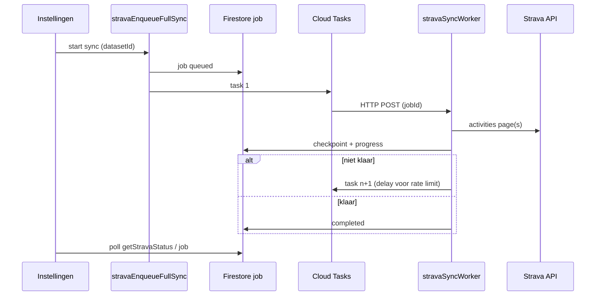

# Strava — fase na Phase 2 (volledige history & privé)

Status (in de app): privé-toggle, **Ververs Strava-toestemming**, proef/volledige sync, **`__all__`** database-scope, wishlist-clear bij match, **checkpoint-hervatting** (client: `sessionStorage` + auto-resume op instellingen na terugkeer, Screen Wake Lock tijdens sync). **Nog open:** echte achtergrond-sync zonder tab open (Scheduler/queue + Functions-deploy), snellere spatial index over alle klimmen.

## Doel (product)

1. **Hele Strava-history** doorlopen (paginatie API), niet alleen 50 ritten.
2. **Optioneel privé-activiteiten** (instellingen: schuifje/checkbox).
3. Per match: **gedaan** aan, **wishlist** uit als die stond.
4. Meerdere **datasets** (alle regio’s in `data/index.json` of gebruikerskeuze), niet alleen één proef-dataset.

## Technisch

### Scopes & opnieuw koppelen

| Modus | Strava scopes |
|--------|----------------|
| Alleen publiek | `read`, `activity:read` (huidige) |
| Inclusief privé | + `activity:read_all` |

- Voorkeur opslaan in Firestore: `users/{uid}/prefs/strava` → `{ includePrivate: boolean, datasetIds: string[], lastFullSyncAt, … }`.
- Bij wijziging naar privé: **Loskoppelen + opnieuw Koppel Strava** zodat Strava de extra scope vraagt (`approval_prompt=force` of disconnect flow).

### Backend

- Nieuwe callable bv. `stravaSyncFull` (of uitbreiden trial):
  - Haal activities met `page`/`per_page` tot leeg (respect rate limits; evt. checkpoint in Firestore).
  - Filter `type === Ride` (en evt. VirtualRide).
  - Zelfde bbox/polyline-match als `functions/strava.js` nu.
  - Batch-writes: `done: true`, `source: "strava"`, `wishlist: false` bij match.
- Timeout: trial gebruikt al 300s; volledige sync kan **meerdere aanroepen** nodig hebben (cursor `before` / laatste activity-id in prefs).
- Optioneel: Cloud Scheduler + queue (later) voor zeer grote accounts.

### Frontend (`settings.html` / `strava-sync.js`)

- Toggle **Publieke + privé activiteiten** (disabled tot scope OK; hint bij scope mismatch).
- Knop **Volledige sync** (met progress: “pagina 3, 450 ritten, 12 matches…”).
- Dataset: multi-select of “alle datasets in index” (zwaar — bbox per dataset laden).
- Status: laatste sync-tijd, aantal verwerkte ritten, fouten.

### Gedrag (afgesproken)

- Sync **overschrijft** handmatige **gedaan** voor gematchte klimmen (zoals nu).
- Wishlist op match: **verwijderen** (niet alleen `done`).
- Geen match: logboek ongewijzigd.

### Deploy / config

Zie [`STRAVA.md`](STRAVA.md). Geen wijziging callback-domein. Na Functions-deploy: zelfde GitHub workflow + `climb-database` project.

## Volgorde implementatie (voorstel)

1. Firestore prefs + UI toggle (zonder sync) + scope-detectie in `getStravaStatus`.
2. `stravaSyncFull` met paginatie + checkpoint (één dataset).
3. Wishlist-clear in batch writes.
4. Multi-dataset loop + UI.
5. Privé scope + filter op activity `private` flag wanneer toggle uit.

---

## Phase 3 — background jobs (sync zonder tab)

**Doel:** een gebruiker start **één keer** “Volledige history sync” en kan de browser sluiten; de server loopt batches af tot de Strava-history (en gekozen scope) verwerkt is. Voortgang is zichtbaar bij terugkeer op Instellingen.

**Verschil met nu (Phase 2 + client-hervatting):** de browser blijft de orchestrator via herhaalde `stravaSyncFull`-callables. Phase 3 verplaatst die loop naar **Firebase + Cloud Tasks** (of vergelijkbaar).

### Wat er al is (hergebruiken)

| Onderdeel | Locatie | Rol in Phase 3 |
|-----------|---------|----------------|
| Batch-sync + match | `functions/strava.js` → `stravaSyncFullHandler` | Zelfde logica in **worker** (één batch per task) |
| Checkpoint | `users/{uid}/integrations/strava.fullSyncCursor` | Worker leest/schrijft cursor; geen dubbel model |
| Voorkeuren | `users/{uid}/prefs/strava` | `includePrivate`, dataset-scope |
| Status in UI | `getStravaStatus` → `lastSyncSummary` | Uitbreiden met **job-status** (queued/running/done) |

### Nieuw datamodel (voorstel)

Firestore-document `users/{uid}/stravaSyncJobs/{jobId}`:

```json
{
  "status": "queued | running | completed | failed | cancelled",
  "datasetId": "cf-l… | __all__",
  "includePrivate": true,
  "createdAt": "<server timestamp>",
  "updatedAt": "<server timestamp>",
  "error": null,
  "progress": {
    "activitiesScanned": 0,
    "uniqueClimbs": 0,
    "nextPage": 2,
    "regionIndex": 0
  }
}
```

- Maximaal **één** actieve job per gebruiker (`status` in `queued`/`running`).
- Bij start: `reset: true` op eerste batch; vervolg batches `reset: false` (zoals nu).

### Architectuur (aanbevolen)



1. **Callable `stravaEnqueueFullSync`** (of uitbreiding van full sync): valideert auth, scope, geen dubbele job → maakt job-doc → enqueued eerste task.
2. **HTTP worker `stravaSyncWorker`** (Gen2, regio `europe-west1`): laadt job + tokens, roept intern dezelfde batch-code aan als `stravaSyncFullHandler` (refactor naar gedeelde module).
3. **Cloud Tasks queue** `strava-sync`: retry met backoff; optionele `scheduleTime` (+15–30 s) tussen batches voor Strava rate limits.
4. **IAM:** queue service account mag worker aanroepen (OIDC); worker mag Firestore + Secrets lezen.

**Alternatief (lichter, minder schaalbaar):** Cloud Scheduler elke 2 min → callable “verwerk alle open jobs één stap”. Eenvoudiger, trager, geen per-user pacing.

### Frontend (kleine wijzigingen)

- Knop **Volledige sync** → `stravaEnqueueFullSync`; status: “Sync op server… pagina 12, 600 ritten”.
- Poll `getStravaStatus` (of `getStravaSyncJob`) elke 10–30 s zolang job `running`; optioneel push later.
- Client **sessionStorage-hervatting** blijft nuttig als fallback wanneer worker nog niet live is.

### Deploy & infra (checklist)

| Item | Nodig voor Phase 3 |
|------|---------------------|
| Workflow **Deploy Climbfinder import function** | Ja — nieuwe functions exporteren |
| GitHub Secrets `STRAVA_*` | Ja (bestaand) |
| Firestore Native | Ja (bestaand) |
| **Cloud Tasks API** inschakelen | Ja |
| Queue + dead-letter / max attempts | Aanbevolen |
| Functions Gen2 + timeout/memory per batch | Ja (nu al ~300 s / 1 GB voor full sync) |
| Firestore security rules voor `stravaSyncJobs` | Alleen eigen `uid` |
| Cloud Scheduler | Optioneel (nachtelijke re-sync) |
| FCM / e-mail “sync klaar” | Optioneel |

Geen wijziging aan Strava **callback-domein** (`vccharlie.github.io`). Zie [`STRAVA.md`](STRAVA.md).

### Rate limits & fouten

- Strava: respecteer 429 → task retry met exponential backoff (Tasks-config).
- Verlopen refresh token → job `failed`, UI: “Koppel Strava opnieuw”.
- `deadline-exceeded` in één batch → worker markeert job nog `running`, volgende task pakt `fullSyncCursor` op (zelfde als nu in de browser-loop).

### Implementatievolgorde (Phase 3)

1. Refactor: `runStravaSyncBatch(uid, { datasetId, reset })` uit `stravaSyncFullHandler` (unit-testbaar).
2. Firestore job + `stravaEnqueueFullSync` + worker + Tasks queue (één dataset).
3. `__all__`-scope in worker (zelfde cursor `mode: "all"` als nu).
4. UI: job-status i.p.v. lange browser-loop; behoud proef-sync callable.
5. Optioneel: Scheduler + notificaties; spatial index voor snellere `__all__`-matches (los van jobs).

### Niet in Phase 3

- Sync **zonder** Firebase Functions deploy (blijft onmogelijk — tokens zitten server-side).
- Volledig “offline” Strava — altijd API + Firestore.
